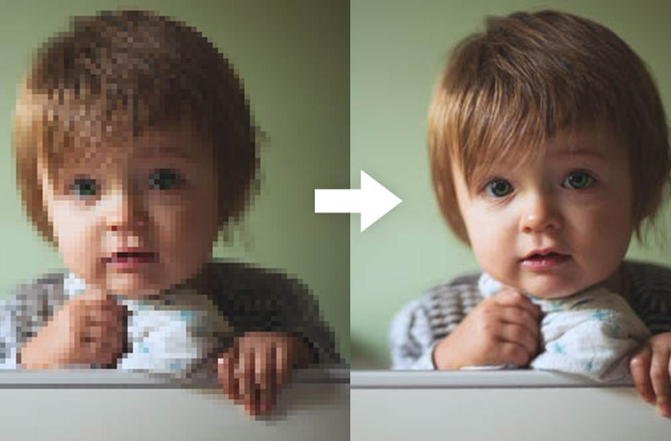

# Задача повышения разрешения изображения
В связи с различными ограничениями устройств для фото- и видеосъемки качество получаемых данных может быть недостаточным для решения целого ряда задач, например, для идентификации номеров автомобилей, лиц людей и т.д. Для решения таких проблем используются методы повышения разрешения изображений.

## Постановка задачи 
На вход подается изображение малого разрешения. На выходе получается исходное изображение с большим разрешением.

**Вход**: Изображение низкого разрешения в формате *.png*, *.bmp*, *.jpg*

**Выход**: Исходное изображение с восстановленным высоким разрешением
 
 

Рисунок 1. Пример изображения в низком разрешении и в повышенном разрешении

## Пример набора данных
Для данной задачи набор данных можно создать самим из имеющихся открытых датасетов (ImageNet, CoCo и т.д.) с помощью инструментов понижения размерности изображений (например, в cv2 метод resize()).

## Предлагаемые архитектуры
•	SRGAN (https://arxiv.org/abs/1609.04802)

---
### Источники
"ПРАКТИКУМ
ПО КУРСУ «ТЕХНОЛОГИИ ИСКУССТВЕННОГО ИНТЕЛЛЕКТА И НЕЙРОСЕТЕВОЙ АНАЛИЗ ДАННЫХ»", авторы: Н.С. Давыдов, А.В. Никоноров