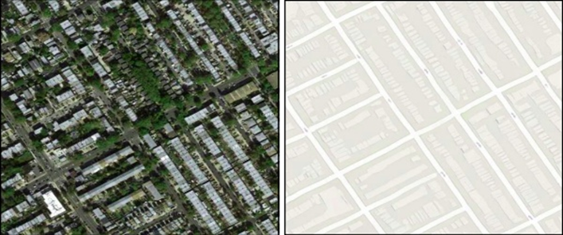

# Генерация карты из изображения со спутника
Снимки со спутников применяются в различных областях дистанционного зондирования: сельское хозяйство, прогнозирование погодных условий, военная разведка и прочее. Одним из таких направлений является своевременная генерация схематических карт на основе изображений из космоса, что позволяет поддерживать карты городов и их окрестностей в актуальном состоянии.

## Постановка задачи 
На основе набора входных изображений, полученных со спутника, создается схематическое изображение карты с характерными способами отрисовки объектов (дороги, леса, здания и т.д.).

**Вход**: Изображение низкого разрешения в формате *.png*, *.bmp*, *.jpg*

**Выход**: Изображение карты в формате *.png*, *.bmp*, *.jpg*
 
 

Рисунок 1. Слева – изображение, полученное со спутника. Справа – сгенерированное схематическое представление карты.

## Пример набора данных
•	http://efrosgans.eecs.berkeley.edu/pix2pix/datasets/

## Предлагаемые архитектуры
•	pix2pix (https://arxiv.org/abs/1611.07004)

---
### Источники
"ПРАКТИКУМ
ПО КУРСУ «ТЕХНОЛОГИИ ИСКУССТВЕННОГО ИНТЕЛЛЕКТА И НЕЙРОСЕТЕВОЙ АНАЛИЗ ДАННЫХ»", авторы: Н.С. Давыдов, А.В. Никоноров