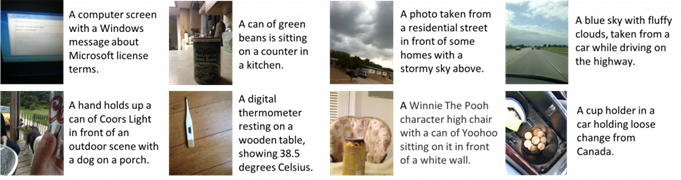

# Генерация текстового описания к изображению
Всестороннее понимание зрения и языка и их взаимосвязей имеет решающее значение для понимания основных сходств и различий между этими модальностями и для изучения более обобщенных, значимых представлений. Автоматическая генерация описаний к изображениям может помогать исследователям в разметке данных, сокращать трудозатраты к описанию больших наборов изображений в каталогах и т.д.

## Постановка задачи 
На вход подается изображение, содержащее некую смысловую нагрузку. На выходе получается описание на естественном языке исходного изображения.

**Вход**: Изображение низкого разрешения в формате *.png*, *.bmp*, *.jpg*

**Выход**: Текстовое описание исходного изображения на естественном языке.
 
 

Рисунок 1. Пример изображений и их описаний.

## Пример набора данных
•	https://vizwiz.org/tasks-and-datasets/image-captioning/

•	https://storage.googleapis.com/openimages/web/index.html

## Предлагаемые архитектуры
•	https://arxiv.org/abs/2112.04928

---
### Источники
"ПРАКТИКУМ
ПО КУРСУ «ТЕХНОЛОГИИ ИСКУССТВЕННОГО ИНТЕЛЛЕКТА И НЕЙРОСЕТЕВОЙ АНАЛИЗ ДАННЫХ»", авторы: Н.С. Давыдов, А.В. Никоноров